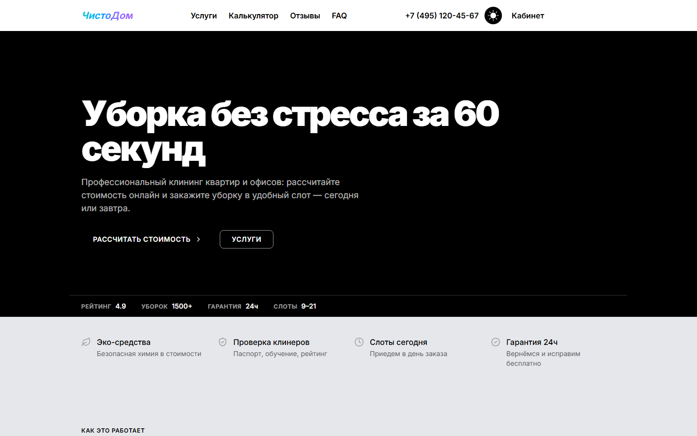

# ЧистоДом — уборка квартир и офисов за 60 секунд



Демо-лендинг клининговой службы с настоящей бизнес-логикой: калькулятор
считает стоимость по площади и допам, оформление заказа сохраняет его
в личный кабинет. Сделан в стиле «монохромная газета + один градиент» —
чёрный холст, белые заголовки, акцент только на действиях.

**Live:** локальный запуск (публичного деплоя нет) ·
**Код:** [Zurux1337/cleaningsite](https://github.com/Zurux1337/cleaningsite)

## Что внутри

- **Hero** с ключевыми цифрами: рейтинг, число уборок, гарантия 24 ч, слоты.
- **Калькулятор в 4 шага**: тип уборки → площадь и допы → дата и время → контакты.
  Цена пересчитывается на каждом шаге.
- **Тарифы** четырёх уровней с честным сравнением.
- **До/после** — интерактивное сравнение фотографий.
- **Фейк-оплата**: диалог карты/наличных с задержкой и защитой от двойного сабмита.
- **Личный кабинет**: заказы из `localStorage`, статусы, отмена.
- **Тёмная/светлая тема** с сохранением выбора и учётом системной настройки.

## Дизайн

- Стиль: `a16z-speedrun` (библиотека портфолио, `styles/references/a16z-speedrun.md`) —
  чёрный фон, крупный жирный гротеск, тонкие hairline-разделители,
  единственный градиентный акцент.
- Шрифт: Inter.
- Радиусы минимальные, тени отсутствуют, иерархия строится размером и весом.
- Анимации: reveal-появления секций и тумблер темы по мотивам Skiper UI.
  Всё отключается при `prefers-reduced-motion`.

## Стек

Next.js 16 · React 19 · TypeScript · Tailwind CSS 4 · motion · GSAP ·
Lenis · Radix UI · sonner · Embla · Vitest

## Структура

```
src/
├─ app/                # layout, главная страница
├─ components/         # секции лендинга + Calculator, BookingFlow, диалоги
│  └─ ui/              # button, input, card, carousel
├─ data/prices.ts      # тарифы за м², допы, слоты, лимиты
└─ lib/
   ├─ price.ts         # формула цены (+ тесты)
   ├─ orders.ts        # заказы в localStorage (+ тесты)
   ├─ phone.ts         # нормализация телефона (+ тесты)
   └─ theme.tsx        # провайдер темы
```

## Формула цены

```
total = max(2500, база × площадь + допы) × (экспресс ? 1.3 : 1)
```

- База за м²: поддерживающая 129 ₽, генеральная 199 ₽, после ремонта 249 ₽, офис 149 ₽.
- Допы: окна 1990 ₽, холодильник 790 ₽, духовка 890 ₽, балкон 1490 ₽, глажка 590 ₽, химчистка 990 ₽.
- Минимальный заказ 2500 ₽; экспресс-коэффициент 1.3; округление до рубля.
- Пример: генеральная 45 м² + окна = 199 × 45 + 1990 = **10 945 ₽**.

## Запуск

```bash
npm install
npm run dev      # http://localhost:3000
```

## Проверки

```bash
npm run lint
npm run typecheck
npm run build
npx vitest run
```

## Демо-дисклеймер

Оплата имитируется: деньги не списываются, платёжный шлюз не подключён.
Заказы живут только в браузере (`localStorage`) и не уходят на сервер.
Телефон, тарифы и отзывы — вымышленные.
